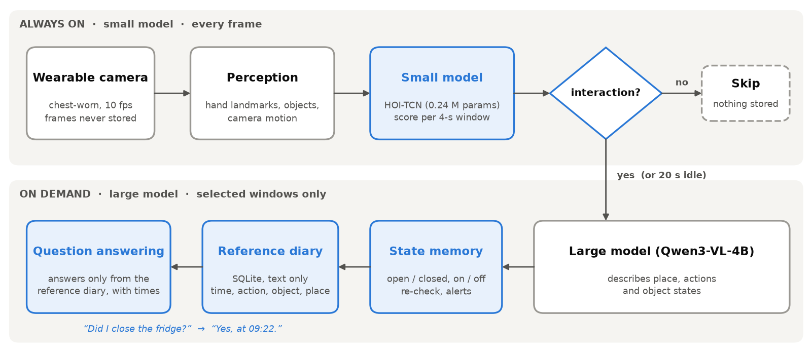
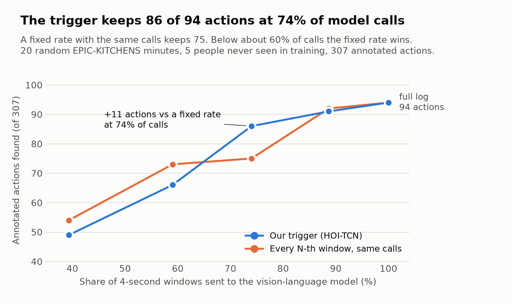
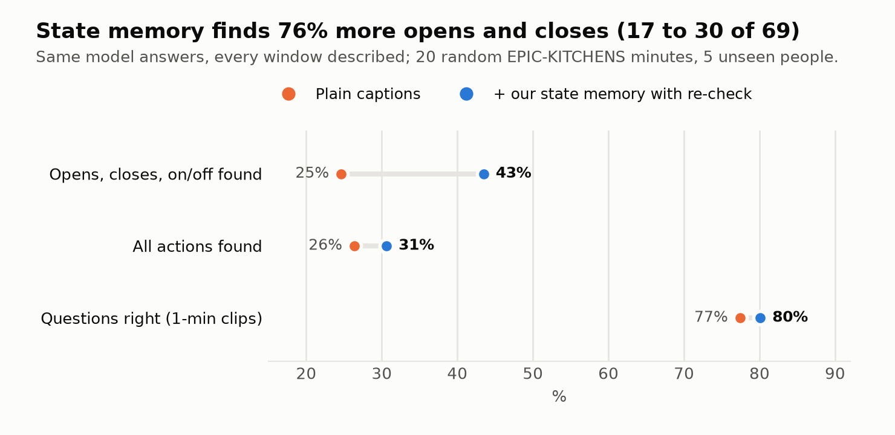
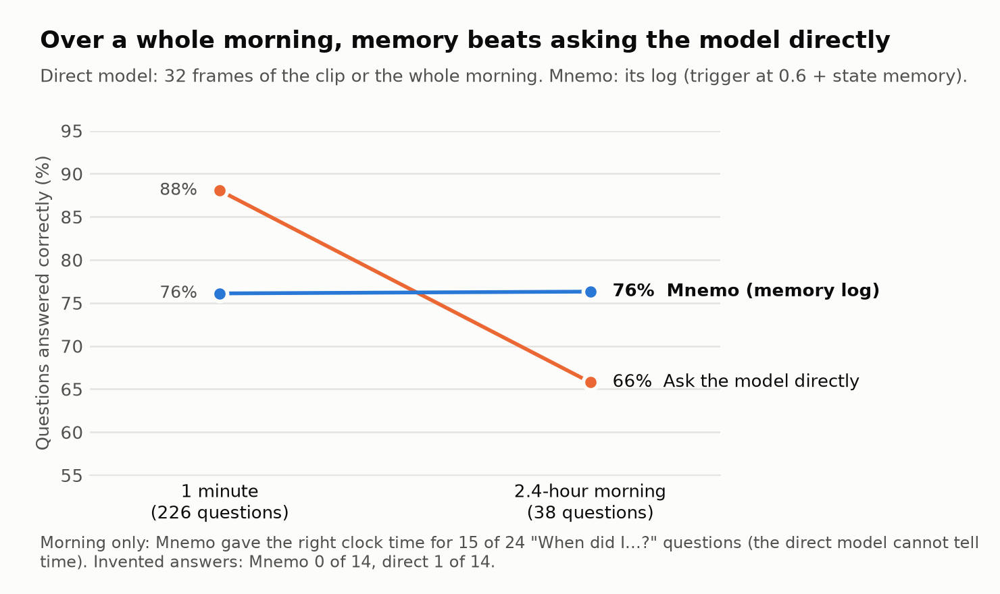

<div align="center">

# Mnemo

**A wearable memory assistant that remembers what you *did*, not what you saw.**

[](LICENSE)


</div>

People with short-term memory problems often cannot tell whether they closed the fridge, switched off the
stove or took their medicine. Mnemo watches through a chest-worn camera and writes down what the wearer
**did** as short, time-stamped lines of text. It never stores a frame. Later it answers questions from that
record alone:

> **"When did I open the oven?"** → *"You opened the oven at 09:00:00–09:00:04 and again at 09:37:50–09:37:54, both in the kitchen."*
> **"Did I take my medicine?"** → *"I didn't see that in my records."*

In our paper (in preparation), the method is called **ENGRAM** (*Egocentric Neural Grounded Retrieval of
Actions and Moments*), and the text record is called the **reference diary**.

<p align="center"></p>

## How it works

Mnemo uses two models. A small one runs all the time, and a large one runs only when needed.

1. **Always on (cheap, CPU).** For every frame, MediaPipe Hands, YOLOv8n and sparse optical flow produce a
   105-dimensional hand, object and camera-motion feature. **HOI-TCN**, our causal temporal CNN with 0.24 M
   parameters, scores each 4-second window for hand–object interaction.
2. **On demand (expensive, GPU).** Only the windows it selects, plus one window every 20 s as a heartbeat, go to
   **Qwen3-VL-4B**. The model writes short structured lines instead of free captions:
   ```
   PLACE: kitchen counter
   STATE: fridge = open
   DID: put | milk | fridge
   ```
3. **Object-state memory.** When an object's reported state changes, Mnemo writes the matching action, e.g.
   *closes fridge*. The VLM rarely says "closed" on its own, so Mnemo asks it again about objects it believes
   are still open. Objects left open produce alerts such as *"the fridge was last seen open at 9:22"*.
4. **Reference diary.** One SQLite table, text only. A 2.4-hour morning takes 636 rows in 240 kB.
5. **Grounded answers.** The question is matched against the diary, and the same model answers **only from
   the matching rows**, with times and places. If the rows don't answer it, Mnemo declines.

The blue boxes in the figure are this project's contributions. The pre-trained models are used as
components.

## Results

**Test setup:**
- 20 random one-minute EPIC-KITCHENS-100 clips, 307 annotated actions (69 of them opening, closing or
  switching).
- The clips come from 5 people HOI-TCN never saw in training.
- Qwen3-VL-4B ran on one Kaggle T4.
- Scoring is strict: a diary row counts only if it has the exact EPIC verb and noun class within ±2 s.

| What was measured | Result |
|---|---|
| HOI-TCN pick-up / put-down events, held-out people (±1 s) | F1 0.529 (precision 0.45, recall 0.65) |
| Trigger vs. evenly spaced calls, same budget (74% of windows) | **86 vs. 75** actions kept (gain +11, 95% CI +2 to +20) |
| VLM time per second of video | 1.64 s → **1.22 s** |
| Object-state memory: open / close / on / off actions found | **17 → 30** of 69 |
| Questions about a whole 2.4-hour morning | **76%** correct vs. 66% for the VLM shown the whole morning |
| Invented events (questions about things that never happened) | **0 of 14** vs. 1 of 14 |
| "When did I …?" answered with the right clock time | **15 of 24** (the direct VLM cannot tell time) |

<p align="center">
  
  
</p>
<p align="center">
  
</p>

**Where Mnemo does not win.** These results are reported too:
- **One-minute clips.** Asking the VLM directly is better here (88% vs. 76%). Thirty-two frames cover a
  minute well, and the diary misses actions it never recorded. The diary pays off over long periods.
- **Tight budgets.** Below about 60% of calls, evenly spaced calls find as many actions as the trigger or a
  few more (both confidence intervals include zero). The threshold τ = 0.6 was chosen at the knee of this
  curve on the same clips, so the benchmark reports every threshold.
- **"Any action" trigger.** A head trained on the busiest EPIC minutes did not beat the pick-up / put-down
  trigger (`model/train_interaction.py`, kept as a negative result).

<details>
<summary><b>Example: part of a morning's diary and answers generated from it</b></summary>

```
09:22:46  opens fridge                  (kitchen)
09:22:46  picks up milk bottle          (kitchen)
09:22:46  closes fridge                 (kitchen)
09:23:02  puts down box of cornflakes   (kitchen counter)
09:23:14  pours coffee                  (into cup)

Q: When did I open the oven?
A: You opened the oven at 09:00:00–09:00:04 and again at 09:37:50–09:37:54, both in the kitchen.

Q: Did I take my medicine?
A: I didn't see that in my records.
```
The coffee being poured is recorded, but the cup being picked up is not. That is a typical miss.
</details>

## Quick start

### Install
```bash
git clone https://github.com/slikhithreddy22/MNemo.git
cd MNemo
python -m venv .venv && source .venv/bin/activate
pip install -r requirements.txt --extra-index-url https://download.pytorch.org/whl/cpu
python -m pytest            # 87 tests on synthetic data, about a minute on a laptop CPU
```
Tested on Linux with Python 3.14. The trained trigger ships in the repo (`models/hoi_tcn.pt`, 1 MB). The
MediaPipe hand model and YOLOv8n download automatically the first time they are used.

### Video → diary → answers (GPU)
```bash
pip install "transformers>=4.57" accelerate
python mnemo.py log kitchen.mp4 --start "2026-10-17 08:30" --trigger    # HOI-TCN decides when the VLM looks
python mnemo.py activities                                              # print the diary
python mnemo.py qa "did I close the fridge?" --llm                      # grounded answer, with times
```
- Qwen3-VL-4B needs a 16 GB GPU such as a T4. To use a smaller model, set `VLM_MODEL` in `config.py` to
  `Qwen/Qwen3-VL-2B-Instruct`, which is also faster.
- Without `--llm`, `qa` lists the matching diary rows and needs no GPU.

### No GPU? Run it on Kaggle
Package the code with `python -m tools.make_colab_zip`, upload `mnemo_code.zip` as a Kaggle dataset, then
open one of these notebooks with a T4:

| Notebook | What it does |
|---|---|
| [`colab/mnemo_live_demo.ipynb`](colab/mnemo_live_demo.ipynb) | Any first-person video → diary → type your own questions |
| [`colab/mnemo_kaggle.ipynb`](colab/mnemo_kaggle.ipynb) | The full benchmark above: trigger, state memory, QA and whole-morning test |
| [`colab/mnemo_ego4d.ipynb`](colab/mnemo_ego4d.ipynb) | Ego4D Natural Language Queries test (needs an Ego4D licence) |
| [`colab/mnemo_vlm.ipynb`](colab/mnemo_vlm.ipynb) | Stage 1 + stage 2 on Google Colab |
| [`colab/mnemo_train.ipynb`](colab/mnemo_train.ipynb) | Train HOI-TCN on public datasets |

### Pick-up / put-down mode (CPU only)
The original mode needs no GPU. It tracks a few personal objects and remembers where each was put down:
```bash
python mnemo.py run recording.mp4 --mode model --show     # or: run 0 --show for a live camera
python mnemo.py ask "where is my wallet?"
python mnemo.py simulate --days 14                        # SIMULATED history for the habit demo
python mnemo.py habits --simulated
```
For setting places, fine-tuning on your own objects and evaluating on your own videos, see
[docs/own_footage.md](docs/own_footage.md).

## Reproducing the results
1. Run `colab/mnemo_kaggle.ipynb` on Kaggle. It writes `mnemo_results.zip`.
2. Unzip it and draw the figures:
   ```bash
   python -m evaluation.make_figures --results <unzipped folder> --out docs/figures
   ```

How the data is split:
- All splits are **by person**. HOI-TCN trained on 22 EPIC participants and validated on P04, P21, P22, P27
  and P31. Early stopping and its decision threshold used the validation people.
- Every result above comes from the test participants P02, P06, P08, P14 and P26.
- The trigger threshold τ = 0.6 was read off the test curve. That is why every threshold is reported.

| Piece | Code |
|---|---|
| Small model (HOI-TCN) | `model/architecture.py`, `model/train.py`, `model/evaluate.py` |
| Trigger | `modules/hoi_gate.py` |
| VLM describer + object-state memory | `modules/vlm_logger.py` |
| Grounded answers / moment search | `query/llm_qa.py`, `query/locate.py` |
| Benchmark (one VLM pass, replayed for every system) | `evaluation/benchmark.py`, `evaluation/log_accuracy.py`, `evaluation/qa_benchmark.py` |
| Whole-morning test | `evaluation/long_qa.py` |
| Ego4D NLQ test | `evaluation/ego4d_nlq.py`, `tools/fetch_ego4d.py` |

## Repository layout
```
mnemo.py        command-line entry point: run, ask, log, qa, activities, habits, enroll, simulate
config.py       every setting in one place (values marked TUNE are starting points)
modules/        runtime: video source, perception (hands, objects, camera motion), features,
                trigger (hoi_gate.py), stage 1 + state memory (vlm_logger.py), storage, habits
model/          HOI-TCN: architecture, feature extraction, training, evaluation, metrics
query/          stage 2: grounded answers, moment search, rule-based "where is X?"
evaluation/     benchmark, diary accuracy, QA, whole-morning test, Ego4D NLQ, figures
tools/          dataset fetchers (EPIC windows, Ego4D clips), labelling tool, demo video, code zip
detect/         YOLOv8 fine-tuning for your own objects
colab/          Kaggle and Colab notebooks
tests/          pytest suite (synthetic data, no dataset downloads)
docs/           figures, demo page template, own-footage guide
```

## Privacy
- Frames are kept only in a RAM buffer, and only while their window is processed. Nothing visual is written
  to disk. `tests/test_privacy_and_pipeline.py` runs the real pipeline with every image-writing function
  blocked and checks that no image or video file appears.
- The diary is plain text in a local SQLite file, and the whole system can run on one machine.
- The text can still be sensitive. A real deployment needs encryption and user-controlled deletion.

## Limitations
- **Kitchens only, head-mounted cameras.** All numbers come from EPIC-KITCHENS-100, which was filmed with
  head-mounted cameras. Mnemo is meant to be worn on the chest.
- **Strict scoring.** Recall of 26–31% looks low because a row only counts with the exact EPIC verb and noun
  ("mug" vs. "cup" is a miss). Read the numbers as comparisons between systems that share the same VLM outputs.
- **Small morning test.** It joins separate clips rather than one continuous recording, and has 38 questions.
- **Narrow trigger.** HOI-TCN was trained on pick-up and put-down only. Actions like stirring or wiping are
  caught mainly by the 20-second heartbeat.
- **Not a medical device.** There has been no user study. Mnemo is a research prototype.

## Roadmap
- [ ] Ego4D Episodic Memory (NLQ) on held-out clips: the code is in place and the full run is pending
- [ ] Hybrid keyword + vector search over the diary
- [ ] Continuous chest-camera recordings
- [ ] Mobile app and a user study

## Data, models and licences
This repository contains **no videos and no dataset files**. Get each dataset from its owners under its
licence.

| Component | Licence | Used for |
|---|---|---|
| [EPIC-KITCHENS-100](https://epic-kitchens.github.io/) | CC BY-NC 4.0 | training HOI-TCN and all results above |
| [Ego4D](https://ego4d-data.org/) | Ego4D licence agreement | NLQ test; clips must not be redistributed |
| [MediaPipe Hand Landmarker](https://ai.google.dev/edge/mediapipe/solutions/vision/hand_landmarker) | Apache-2.0 | hand landmarks (downloaded on first use) |
| [Ultralytics YOLOv8 / YOLO-World](https://github.com/ultralytics/ultralytics) | AGPL-3.0 | object detection (downloaded on first use) |
| [Qwen3-VL-4B-Instruct](https://huggingface.co/Qwen/Qwen3-VL-4B-Instruct) | Apache-2.0 | describing windows and answering questions |
| [OpenCLIP](https://github.com/mlfoundations/open_clip) | MIT | place matching in the pick-up / put-down mode |

- **Mnemo's own code** is released under the [MIT licence](LICENSE).
- **The HOI-TCN weights** (`models/hoi_tcn.pt`) were trained on EPIC-KITCHENS-100 only. Treat them as
  non-commercial too.
- **Ultralytics is AGPL-3.0.** If you distribute a product that includes it, its terms apply to that
  product.

## Citation
The paper citation will be added once it is published. Until then:
```bibtex
@software{mnemo2026,
  title  = {Mnemo: a wearable memory assistant with an interaction-triggered reference diary},
  author = {{The Mnemo authors}},
  year   = {2026},
  url    = {https://github.com/slikhithreddy22/MNemo}
}
```

## Acknowledgements
This project builds on the EPIC-KITCHENS-100 and Ego4D datasets, MediaPipe, Ultralytics, Qwen3-VL, OpenCLIP,
PyTorch and Hugging Face Transformers. The experiments ran on Kaggle's free T4 GPUs.
